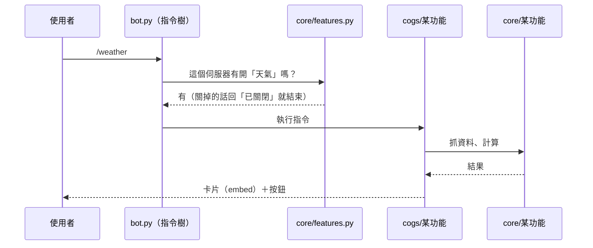
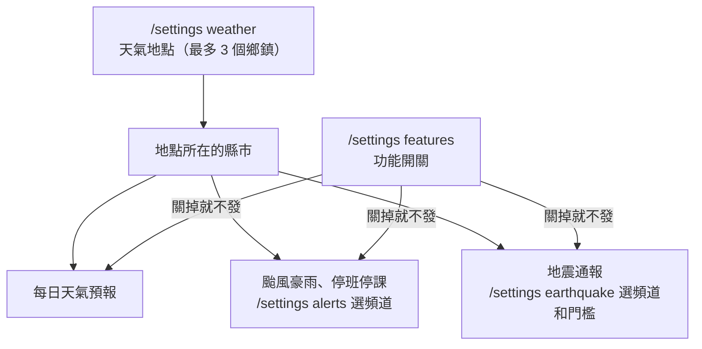

# 架構

想改程式或加功能時看這份。GitHub 上會把下面的圖畫出來。

## 整體

```mermaid
flowchart LR
    U[Discord 使用者] -->|斜線指令、按鈕、@嘎哇| B[bot.py<br/>載入功能、同步指令、功能開關檢查]
    B --> C[cogs/<br/>各功能的 Discord 介面]
    C --> K[core/<br/>不依賴 Discord 的邏輯]
    K --> DB[(data/bot.db<br/>SQLite)]
    W[webadmin/<br/>管理後台網頁] --> DB
    B --> W

    K -.-> CWA[中央氣象署 API<br/>天氣、特報、地震]
    K -.-> DGPA[人事行政總處<br/>停班停課網頁]
    K -.-> OL[Ollama<br/>AI，選用]
    K -.-> GH[GitHub API<br/>專案整合，選用]
    K -.-> TW[twfolio 資料庫<br/>股票，進階]
    C -.-> MC[Minecraft 控制腳本<br/>進階]
    C -.-> YT[YouTube<br/>yt-dlp + ffmpeg]
```

實線是一定會有的部分，虛線是外部服務：沒設定時對應的功能會停用，其他功能照常。啟動時紀錄裡的「功能總覽」會列出目前哪些能用。

## 功能、檔案與設定

| 功能 | Discord 介面 | 邏輯 | 需要的設定 |
|---|---|---|---|
| 大廳、說明 | `cogs/hub.py` | `core/catalog.py` | — |
| 錢包、簽到、打工、任務 | `cogs/economy.py`、`cogs/earn.py` | `core/db.py`、`core/quests.py` | — |
| 21 點、拉霸、猜數字、井字、德州撲克 | `cogs/blackjack.py` 等、`cogs/poker/` | `cogs/poker/engine.py` | — |
| 骰寶（押大小） | `cogs/sicbo.py` | `core/sicbo.py`（押法、賠率、結算） | — |
| 海龜湯 | `cogs/seatortoise.py` | `content/seatortoise.json` | `OLLAMA_URL` |
| 提醒、投票 | `cogs/reminders.py`、`cogs/polls.py` | `core/db.py` | — |
| 待辦、專案、週報 | `cogs/tasks.py`、`cogs/projects.py`、`cogs/github_sync.py` | `core/tasks.py`、`core/github.py` | 週報 AI 總結要 `OLLAMA_URL`；私人 repo 要 `GITHUB_TOKEN` |
| 天氣 | `cogs/weather.py` | `core/weather.py`、`content/weather_towns.json` | `CWA_API_KEY` |
| 颱風豪雨、停班停課 | `cogs/alerts.py` | `core/alerts.py` | 特報要 `CWA_API_KEY`；停班停課不用 |
| 地震 | `cogs/earthquake.py` | `core/earthquake.py` | `CWA_API_KEY` |
| 嘎哇聊天 | `cogs/assistant.py` | `core/assistant.py`、`core/ai.py`、`core/persona.py`（個性設定） | `OLLAMA_URL` |
| AI 記憶 | `cogs/memory.py`（`/memory`）、`cogs/assistant.py`（聊天時讀寫） | `core/memory.py`、`core/db.py`（`ai_memories` 資料表） | `OLLAMA_URL` |
| 我錯過了什麼 | `cogs/catchup.py` | `core/catchup.py` | `OLLAMA_URL`（沒有也能列概況） |
| 更新日誌 | `cogs/changelog.py` | `core/changelog.py`（讀 git 紀錄） | 要用 `git clone` 下載 |
| 音樂 | `cogs/music.py` | `core/music.py` | 系統要裝 ffmpeg |
| 股票模擬 | `cogs/stocks.py` | `core/stocks.py` | `TWFOLIO_DB`、`TWFOLIO_CONFIG` |
| 伺服器設定 | `cogs/settings.py` | `core/db.py`（`guild_settings` 資料表） | — |
| 功能開關 | `bot.py`（指令前檢查）、`cogs/settings.py` | `core/features.py` | — |
| 管理後台 | `cogs/webadmin.py` | `webadmin/`、`core/activity.py`（即時指令統計） | `ADMIN_PASSWORD` |
| 自動更新 | `cogs/updater.py` | `core/updater.py` | `AUTO_UPDATE=1` |
| Minecraft | `cogs/minecraft.py` | 主機上的控制腳本 | `MINECRAFT_GUILD_IDS` |

## 一個斜線指令怎麼跑



## 伺服器設定怎麼影響通知



## 目錄

```
bot.py              主程式：載入功能、同步斜線指令、功能開關檢查、啟動功能總覽
core/               不依賴 Discord 的邏輯，方便寫測試
  config.py         讀取 .env
  db.py             SQLite 資料層（所有寫入都排隊處理，不會互相覆蓋）
  features.py       功能開關：哪些指令、按鈕屬於哪個功能，以及功能分類（CATEGORIES）
  overview.py       啟動時的功能總覽
  ui.py             共用的顏色、訊息格式、按鈕介面基底
  i18n.py           指令名稱中文化
  catalog.py        遊戲與指令目錄（大廳、說明共用）
  …                 其他各功能的邏輯（見上表）
cogs/               各功能的斜線指令、按鈕、定時工作
webadmin/           管理後台（aiohttp 網頁）
content/            題庫、鄉鎮清單等資料
docs/               說明文件與給玩家看的介紹網頁（GitHub Pages）
deploy/             Windows、Linux 的安裝與自動啟動腳本
tests/              單元測試：python -m unittest discover -s tests -t .
data/               資料庫與快取（不會上傳）
```

## 加一個新功能

1. 邏輯寫在 `core/新功能.py`（不 import discord，方便測試），介面寫在 `cogs/新功能.py`。
2. 在 `bot.py` 的 `EXTENSIONS` 加上 `"cogs.新功能"`。
3. 在 `core/features.py` 的 `FEATURES` 加一項，管理員才能開關它。
4. 在 `core/i18n.py` 加中文指令名稱、`core/catalog.py` 加說明，`/help` 才會列出。
5. 需要新設定的話：`core/config.py`（`KNOWN_KEYS` 也要加）、`.env.example`、`core/overview.py`。
6. 寫測試，跑 `python -m unittest discover -s tests -t .`。
